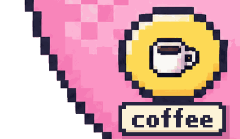
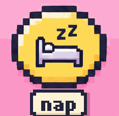
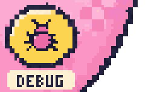

Byte is a tiny pixel dev the internet raises together. 
Press a button on the egg, hit **Create**, and she replies to you in about 30 seconds.

  

💕 raised by @ashleymcnamara · 1 caretaker · 15 presses

 

🥚 also hiding on [@ashleymcnamara's profile](https://github.com/ashleymcnamara) · [play in your browser](https://ashleymcnamara.github.io/devgotchi/)

